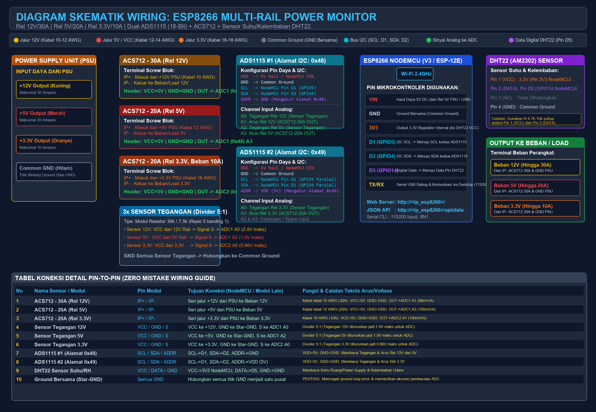
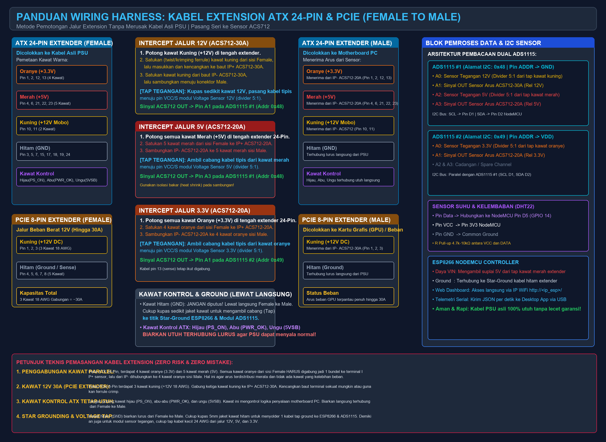

# Proyek ESP8266 Monitoring Multi-Rail Power Supply (High Current)

Proyek sistem pemantauan komprehensif untuk Power Supply Unit (PSU) berbasis mikrokontroler **ESP8266 NodeMCU** menggunakan bahasa pemrograman **Python** (MicroPython untuk mikrokontroler dan Python Desktop GUI untuk komputer).

---

## ⚡ Spesifikasi Sistem & Sensor

| Rel / Parameter | Kapasitas Maksimum | Sensor Arus | Sensitivitas Sensor | Sensor Tegangan |
| :--- | :--- | :--- | :--- | :--- |
| **Rel 12 Volt** | **30 Ampere** | **ACS712-30A** | 66 mV/A | Voltage Divider 5:1 (0–25V) |
| **Rel 5 Volt** | **20 Ampere** | **ACS712-20A** | 100 mV/A | Voltage Divider 5:1 (0–25V) |
| **Rel 3.3 Volt** | **10 Ampere** | **ACS712-20A** | 100 mV/A | Voltage Divider 5:1 (0–25V) |
| **Suhu Lingkungan**| -40°C s.d. +80°C | **DHT22 (AM2302)** | Akurasi ±0.5°C | Komunikasi 1-Wire Digital (Pin D5) |
| **Kelembaban (RH)**| 0% s.d. 100% RH | **DHT22 (AM2302)** | Akurasi ±2% RH | Komunikasi 1-Wire Digital (Pin D5) |
| **ADC Eksternal** | 16-Bit Dual I2C | **Dual ADS1115** | Address 0x48 & 0x49 | Resolusi tinggi pembacaan arus & volt |

---

## 📁 Struktur Direktori Proyek

```text
esp8266_power_monitor/
├── schematics/
│   ├── wiring_diagram.png       <-- Gambar diagram wiring resolusi tinggi (2600x1800)
│   ├── wiring_diagram.svg       <-- Diagram vektor SVG (dapat dibuka di browser)
│   ├── generate_diagram.py      <-- Script generator gambar diagram
│   └── WIRING_GUIDE.md          <-- Panduan pinout detail, rumus, dan kalkulasi aman
├── firmware/
│   ├── boot.py                  <-- Bootloader auto-connect WiFi / fallback AP
│   ├── main.py                  <-- Program utama sensor, web server, REST API
│   ├── ads1115.py               <-- Driver MicroPython ADS1115 16-Bit ADC
│   ├── config.json              <-- Konfigurasi WiFi, pinout, & faktor kalibrasi
│   ├── calibrate.py             <-- Script kalibrasi otomatis arus nol (zero-point)
│   └── upload_to_esp.py         <-- Script 1-klik upload firmware menggunakan mpremote
├── desktop_app/
│   └── desktop_monitor.py       <-- Aplikasi Desktop GUI monitoring (Tkinter)
├── Jalankan_Desktop_Monitor.bat <-- Shortcut klik ganda untuk membuka aplikasi desktop
└── README.md
```

---

## 🔌 Diagram Wiring & Skematik



> [!TIP]
> Gambar di atas adalah diagram skematik koneksi beresolusi tinggi (PNG) yang langsung tampil di semua markdown preview/GitHub.

### 🛠️ Diagram Harness Modifikasi Kabel Extension (ATX 24-Pin & PCIe 8-Pin)



### Dokumen & Berkas Terkait:
- Skematik Lengkap Resolusi Tinggi: [wiring_diagram.png](file:///C:/Users/minipingu/Desktop/esp8266_power_monitor/schematics/wiring_diagram.png) | [wiring_diagram.svg](file:///C:/Users/minipingu/Desktop/esp8266_power_monitor/schematics/wiring_diagram.svg)
- Diagram Modifikasi Extension: [atx_pcie_harness_diagram.png](file:///C:/Users/minipingu/Desktop/esp8266_power_monitor/schematics/atx_pcie_harness_diagram.png)
- Panduan Pemotongan Kabel Extension: [PANDUAN_POTONG_KABEL_EXTENSION.md](file:///C:/Users/minipingu/Desktop/esp8266_power_monitor/schematics/PANDUAN_POTONG_KABEL_EXTENSION.md)
- Panduan tertulis lengkap: [WIRING_GUIDE.md](file:///C:/Users/minipingu/Desktop/esp8266_power_monitor/schematics/WIRING_GUIDE.md)
- Rincian Estimasi Biaya & Harga Pasar: [DAFTAR_HARGA_KOMPONEN.md](file:///C:/Users/minipingu/Desktop/esp8266_power_monitor/DAFTAR_HARGA_KOMPONEN.md)

### Ringkasan Pin Kunci:
1. **Bus I2C (Dual ADS1115):**
   - NodeMCU Pin **D1 (GPIO 5)** $\rightarrow$ Pin **SCL** kedua modul ADS1115.
   - NodeMCU Pin **D2 (GPIO 4)** $\rightarrow$ Pin **SDA** kedua modul ADS1115.
   - **ADS1115 #1**: Pin **ADDR** dihubungkan ke **GND** (Alamat I2C: `0x48`).
   - **ADS1115 #2**: Pin **ADDR** dihubungkan ke **VDD (5V)** (Alamat I2C: `0x49`).
2. **Sensor Suhu/Kelembaban DHT22:**
   - NodeMCU Pin **D5 (GPIO 14)** $\rightarrow$ Pin **DATA** DHT22.
3. **Common Ground (PENTING):**
   - Satukan semua pin GND (NodeMCU, ADS1115, Sensor Tegangan, DHT22, dan GND Power Supply) ke satu titik **Star Ground**.

---

## 🚀 Cara Instalasi & Menjalankan

### 1. Flash Firmware ke ESP8266
Pastikan ESP8266 telah terinstal MicroPython firmware. Buka terminal di folder `firmware` lalu jalankan:
```bash
python upload_to_esp.py
```
*Script ini menggunakan `mpremote` untuk mengunggah `boot.py`, `main.py`, `ads1115.py`, dan `config.json` secara otomatis.*

### 2. Kalibrasi Sensor Arus (Zero-Amp Offset)
Sebelum menghubungkan beban ke rel:
```bash
mpremote run calibrate.py
```
Script akan membaca 100 sampel tegangan baseline nol pada ACS712 dan memperbarui `config.json` secara otomatis.

### 3. Monitoring via Browser (Web Dashboard Bawaan)
ESP8266 memiliki web server internal:
1. Hubungkan PC/HP ke WiFi yang sama dengan ESP8266 (atau hubungkan ke WiFi Access Point `ESP8266-PowerMonitor`).
2. Buka browser dan arahkan ke: `http://<ip_esp8266>/` (atau `http://192.168.4.1/`).
3. Dashboard responsif interaktif akan menampilkan voltase, arus, daya, suhu, dan kelembaban realtime per detik!

### 4. Monitoring via Aplikasi Desktop (Python GUI)
Cukup klik ganda file [Jalankan_Desktop_Monitor.bat](file:///C:/Users/minipingu/Desktop/esp8266_power_monitor/Jalankan_Desktop_Monitor.bat) atau jalankan melalui terminal:
```bash
python desktop_app/desktop_monitor.py
```
Fitur aplikasi desktop:
- Pilihan koneksi: **Serial USB** (115200 bps), **Wi-Fi HTTP Polling**, atau **Mode Simulasi (Demo)**.
- Gauge bar beban realtime dengan indikator warna kapasitas.
- Tombol **Catat CSV** untuk mengekspor data telemetri ke file spreadsheet.
