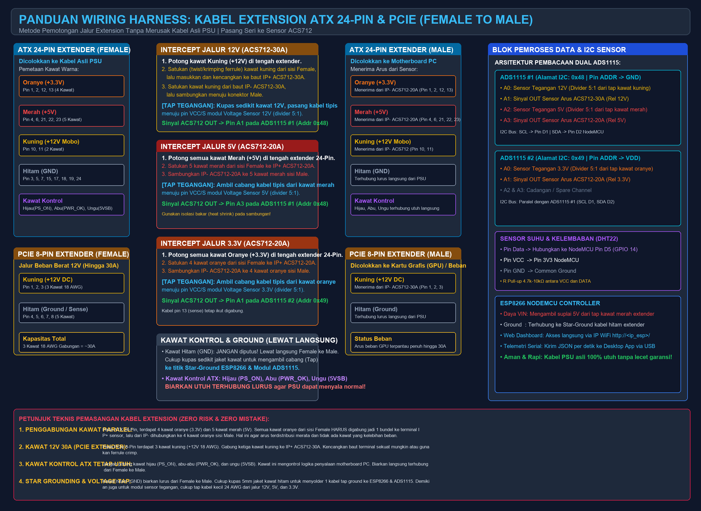

# PANDUAN LENGKAP MODIFIKASI KABEL EXTENSION (ATX 24-PIN & PCIE 8-PIN)
## Metode Intercept Arus Beban Tanpa Merusak Kabel Asli PSU (Plug-and-Play)

Pendekatan menggunakan kabel extension (**Female to Male**) adalah metode terbaik dan paling aman karena:
1. **Garansi PSU Tetap Aman:** Kabel bawaan power supply tidak dipotong atau dimodifikasi sama sekali.
2. **Modular:** Modul monitoring dapat dilepas-pasang dengan mudah kapan saja.
3. **Presisi:** Memungkinkan pengukuran arus riil yang diserap oleh motherboard dan GPU secara terpisah.

---

## 1. Diagram Skematik Pemotongan Kabel

Buka diagram visual resolusi penuh di:
👉 [atx_pcie_harness_diagram.png](file:///C:/Users/minipingu/Desktop/esp8266_power_monitor/schematics/atx_pcie_harness_diagram.png)

---

## 2. Pemetaan Pinout ATX 24-Pin Standar (Molex Mini-Fit Jr.)

| Pin | Warna Kawat | Sinyal / Tegangan | Tindakan pada Kabel Extension |
| :---: | :---: | :--- | :--- |
| **1** | **Oranye** | **+3.3V DC** | **POTONG** $\rightarrow$ Gabung ke IP+ ACS712-20A (Rel 3.3V) |
| **2** | **Oranye** | **+3.3V DC** | **POTONG** $\rightarrow$ Gabung ke IP+ ACS712-20A (Rel 3.3V) |
| **3** | Hitam | Ground | **JANGAN DIPOTONG** (Lewat langsung Female ke Male) |
| **4** | **Merah** | **+5V DC** | **POTONG** $\rightarrow$ Gabung ke IP+ ACS712-20A (Rel 5V) |
| **5** | Hitam | Ground | **JANGAN DIPOTONG** |
| **6** | **Merah** | **+5V DC** | **POTONG** $\rightarrow$ Gabung ke IP+ ACS712-20A (Rel 5V) |
| **7** | Hitam | Ground | **JANGAN DIPOTONG** |
| **8** | Abu-abu | Power Good (PWR_OK) | **JANGAN DIPOTONG** (Sinyal motherboard siap menyala) |
| **9** | Ungu | +5VSB (Standby) | **JANGAN DIPOTONG** (Daya standby motherboard) |
| **10**| **Kuning** | **+12V DC (Mobo)** | Opsional: Lewat langsung atau gabung ke 12V |
| **11**| **Kuning** | **+12V DC (Mobo)** | Opsional: Lewat langsung atau gabung ke 12V |
| **12**| **Oranye** | **+3.3V DC** | **POTONG** $\rightarrow$ Gabung ke IP+ ACS712-20A (Rel 3.3V) |
| **13**| **Oranye** | **+3.3V DC (Sense)** | **POTONG** $\rightarrow$ Gabung bersama kawat oranye lainnya |
| **14**| Biru | -12V DC | **JANGAN DIPOTONG** |
| **15**| Hitam | Ground | **JANGAN DIPOTONG** |
| **16**| Hijau | PS_ON# (Power On Switch)| **JANGAN DIPOTONG** (Jalur tombol power casing/motherboard) |
| **17**| Hitam | Ground | **JANGAN DIPOTONG** |
| **18**| Hitam | Ground | **JANGAN DIPOTONG** |
| **19**| Hitam | Ground | **JANGAN DIPOTONG** |
| **20**| Putih / Kosong| Reserved / NC | - |
| **21**| **Merah** | **+5V DC** | **POTONG** $\rightarrow$ Gabung ke IP+ ACS712-20A (Rel 5V) |
| **22**| **Merah** | **+5V DC** | **POTONG** $\rightarrow$ Gabung ke IP+ ACS712-20A (Rel 5V) |
| **23**| **Merah** | **+5V DC** | **POTONG** $\rightarrow$ Gabung ke IP+ ACS712-20A (Rel 5V) |
| **24**| Hitam | Ground | **JANGAN DIPOTONG** |

---

## 3. Pemetaan Pinout PCIe 8-Pin (6+2 Pin) Standar (Untuk Beban 12V Hingga 30A)

Jalur PCIe 8-Pin adalah jalur utama penyalur daya 12V berarus tinggi ke kartu grafis (GPU) atau beban DC 12V:

| Pin | Warna Kawat | Sinyal / Tegangan | Tindakan pada Kabel Extension |
| :---: | :---: | :--- | :--- |
| **1** | **Kuning** | **+12V DC** | **POTONG** $\rightarrow$ Gabung ke IP+ ACS712-30A (Rel 12V) |
| **2** | **Kuning** | **+12V DC** | **POTONG** $\rightarrow$ Gabung ke IP+ ACS712-30A (Rel 12V) |
| **3** | **Kuning** | **+12V DC** | **POTONG** $\rightarrow$ Gabung ke IP+ ACS712-30A (Rel 12V) |
| **4** | Hitam | Ground | **JANGAN DIPOTONG** (Lewat langsung Female ke Male) |
| **5** | Hitam | Ground | **JANGAN DIPOTONG** |
| **6** | Hitam | Ground / Sense 0 | **JANGAN DIPOTONG** |
| **7** | Hitam | Ground | **JANGAN DIPOTONG** |
| **8** | Hitam | Ground / Sense 1 | **JANGAN DIPOTONG** |

---

## 4. Langkah Demi Langkah Pemasangan (Step-by-Step Assembly)

### Langkah 1: Mempersiapkan Kabel Extension
1. Siapkan 1 buah kabel **ATX 24-Pin Extension (Female to Male)** panjang 30 cm.
2. Siapkan 1 buah kabel **PCIe 8-Pin Extension (Female to Male)** panjang 30 cm.
3. Pisahkan helai kawat di bagian tengah kabel (sekitar 15 cm dari ujung connector).

### Langkah 2: Memotong & Menggabungkan Kawat Rel Arus
> [!IMPORTANT]
> **Mengapa Kawat Harus Digabung?**
> Di dalam ATX 24-pin, arus 3.3V dan 5V dialirkan melalui beberapa kawat paralel berukuran 18 AWG. Masing-masing kawat mampu menghantarkan sekitar 5–7A. Agar mampu menahan beban hingga 20A pada 5V dan 10A pada 3.3V, seluruh kawat paralel tersebut **wajib digabungkan menjadi satu bundel**.

1. **Jalur 3.3V (Rel 10A):**
   - Potong ke-4 kawat **Oranye** di tengah.
   - Sisi **Female** (arah PSU): Kupas ujung isolasi sekitar 1 cm pada ke-4 kawat oranye, pelintir (twist) kuat-kuat menjadi satu, lalu solder atau pasang ferrules tipis. Masukkan ke terminal sekrup **IP+** modul **ACS712-20A**.
   - Sisi **Male** (arah Motherboard): Satukan ke-4 kawat oranye dan masukkan ke terminal sekrup **IP-** modul **ACS712-20A**.

2. **Jalur 5V (Rel 20A):**
   - Potong ke-5 kawat **Merah** di tengah.
   - Sisi **Female** (arah PSU): Satukan ke-5 kawat merah menjadi satu bundel, solder tebal/crimp ferrule, masukkan ke terminal **IP+** modul **ACS712-20A**.
   - Sisi **Male** (arah Motherboard): Satukan ke-5 kawat merah dan masukkan ke terminal **IP-** modul **ACS712-20A**.

3. **Jalur 12V (Rel 30A - dari PCIe Extender):**
   - Potong ke-3 kawat **Kuning** di tengah kabel PCIe extender.
   - Sisi **Female** (arah PSU): Satukan ke-3 kawat kuning menjadi satu bundel tebal, masukkan dan kencangkan sekrup terminal **IP+** modul **ACS712-30A**.
   - Sisi **Male** (arah GPU/Beban): Satukan ke-3 kawat kuning dan kencangkan ke terminal **IP-** modul **ACS712-30A**.

---

### Langkah 3: Mengambil Titik Sadapan Tegangan (Voltage Tap)
Untuk mengukur voltase masing-masing rel tanpa menghambat aliran arus:
1. Siapkan 3 utas kabel kecil (22 AWG atau 24 AWG, panjang $\approx 15\text{ cm}$).
2. Kupas sedikit isolasi pada bundel kawat kuning (+12V), merah (+5V), dan oranye (+3.3V).
3. Solder kabel sadapan kecil tersebut ke masing-masing jalur:
   - Dari sadapan **12V** $\rightarrow$ hubungkan ke pin **VCC / S** pada Modul Sensor Tegangan 12V.
   - Dari sadapan **5V** $\rightarrow$ hubungkan ke pin **VCC / S** pada Modul Sensor Tegangan 5V.
   - Dari sadapan **3.3V** $\rightarrow$ hubungkan ke pin **VCC / S** pada Modul Sensor Tegangan 3.3V.
4. Bungkus rapat sambungan solder dengan isolasi bakar (*heat shrink tubing*) atau electrical tape.

---

### Langkah 4: Common Ground Tap (Ground Bersama)
1. Kawat **Hitam (GND)** pada kedua kabel extension **TIDAK PERLU DIPOTONG PUTUS**.
2. Kupas sedikit isolasi pada salah satu kawat hitam di bagian tengah.
3. Solderkan 1 kawat cabang (*tap*) ground menuju titik **Star-Ground** (terhubung ke pin GND ESP8266, GND kedua modul ADS1115, dan GND ketiga sensor tegangan).
4. Dengan cara ini, ground tetap memiliki impedansi serendah mungkin tanpa rugi tegangan (*ground loop zero*).

---

### Langkah 5: Kawat Kontrol Motherboard (Wajib Utuh)
Pastikan kawat-kawat berikut pada ATX 24-Pin **TIDAK TERGANGGU**:
- **Hijau (PS_ON#):** Berfungsi menyalakan PSU saat tombol power PC ditekan.
- **Abu-abu (PWR_OK):** Sinyal kestabilan tegangan ke BIOS motherboard.
- **Ungu (+5VSB):** Tegangan standby 5V saat komputer dalam kondisi sleep/mati.
- **Biru (-12V):** Tegangan negatif opsional untuk sirkuit audio lawas.
