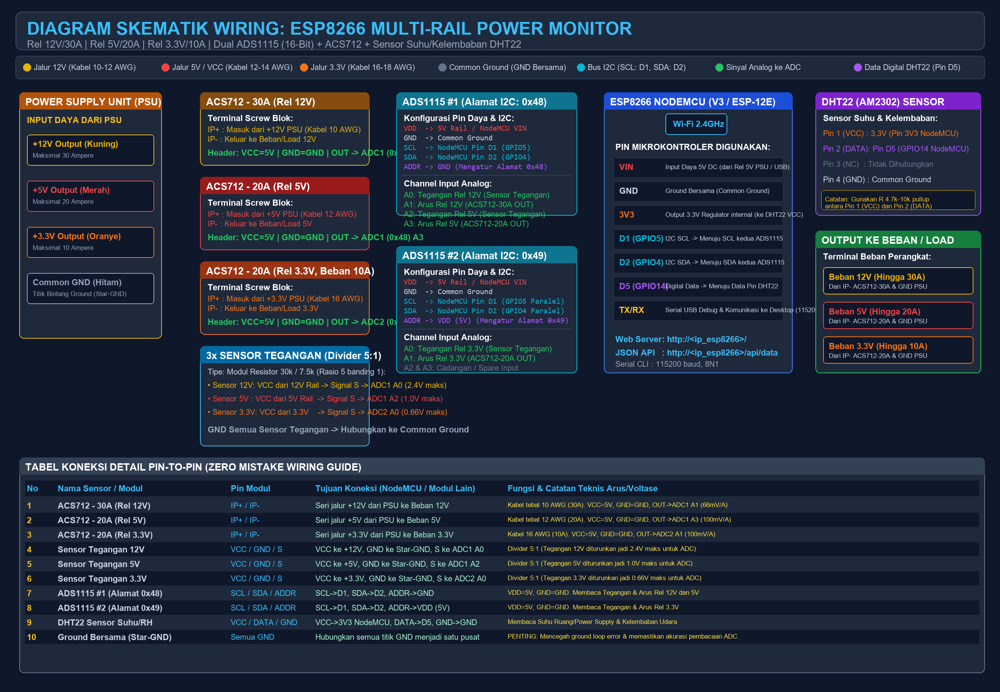

# PANDUAN LENGKAP WIRING & PERHITUNGAN ELEKTRONIKA (ZERO MISTAKE)
## Sistem Monitoring Multi-Rail Power Supply ESP8266 (12V/30A, 5V/20A, 3.3V/10A + DHT22)

Dokumen ini berisi panduan teknis langkah demi langkah untuk merakit hardware monitoring power supply berbasis ESP8266 NodeMCU.

---

## 1. Daftar Komponen yang Diperlukan (BOM - Bill of Materials)
Semua komponen di bawah ini sangat umum dan mudah didapatkan di toko komponen lokal maupun marketplace (Tokopedia / Shopee):

1. **ESP8266 NodeMCU V3 / ESP-12E / WeMos D1 Mini** (1 pcs)
2. **Modul ADC 16-Bit ADS1115 (I2C)** (2 pcs)
   - Modul #1: Alamat `0x48` (Pin ADDR ke GND)
   - Modul #2: Alamat `0x49` (Pin ADDR ke VDD/5V)
3. **Sensor Arus Hall-Effect ACS712:**
   - **ACS712-30A** (1 pcs): Untuk rel 12V (Kapasitas hingga 30A, sensitivitas 66 mV/A)
   - **ACS712-20A** (2 pcs):
     - 1 pcs untuk rel 5V (Kapasitas hingga 20A, sensitivitas 100 mV/A)
     - 1 pcs untuk rel 3.3V (Kapasitas hingga 10A, sensitivitas 100 mV/A)
4. **Modul Sensor Tegangan DC 0-25V (Voltage Divider 5:1)** (3 pcs)
   - Menggunakan kombinasi resistor presisi $30\text{ k}\Omega$ dan $7.5\text{ k}\Omega$.
5. **Sensor Suhu dan Kelembaban:**
   - **DHT22 (AM2302)** atau **DHT11** (1 pcs)
   - Resistor $4.7\text{ k}\Omega - 10\text{ k}\Omega$ sebagai pull-up data (jika modul belum terpasang resistor onboard).
6. **Kabel Arus Tinggi (High-Current Wire):**
   - Jalur 12V (30A): Kabel tembaga serabut **10 AWG atau 12 AWG** (minimal $3.3\text{ mm}^2 - 5.2\text{ mm}^2$).
   - Jalur 5V (20A): Kabel tembaga serabut **12 AWG atau 14 AWG** (minimal $2.0\text{ mm}^2 - 3.3\text{ mm}^2$).
   - Jalur 3.3V (10A): Kabel tembaga serabut **16 AWG** (minimal $1.3\text{ mm}^2$).
7. **Kabel Jumper DuPont** (Male-to-Female, Female-to-Female) untuk sinyal logika I2C & ADC.

---

## 2. Tabel Koneksi Pin-to-Pin Detail (Zero Mistake)

### A. Bus I2C & ESP8266 NodeMCU
Keduanya terhubung paralel pada bus I2C ESP8266:

| Pin ESP8266 NodeMCU | Pin ADS1115 #1 (Addr 0x48) | Pin ADS1115 #2 (Addr 0x49) | Keterangan |
| :--- | :--- | :--- | :--- |
| **D1 (GPIO 5)** | SCL | SCL | Sinyal I2C Clock |
| **D2 (GPIO 4)** | SDA | SDA | Sinyal I2C Data |
| **VIN (5V)** | VDD | VDD | Suplai Daya Analog 5V |
| **GND** | GND | GND | Common Ground |
| *(Pin GND)* | **ADDR** -> GND | - | Menetapkan Alamat I2C `0x48` |
| *(Pin VDD 5V)* | - | **ADDR** -> VDD | Menetapkan Alamat I2C `0x49` |

---

### B. Pemetaan Input Analog ADS1115 #1 (Alamat 0x48)

| Channel ADS1115 #1 | Terhubung ke | Sumber Sinyal | Skala / Konversi |
| :--- | :--- | :--- | :--- |
| **A0** | Sensor Tegangan Rel 12V (Pin S) | Pembagi tegangan 5:1 | $V_{in} = V_{sensor} \times 5.0$ (Maks 12V = 2.4V) |
| **A1** | ACS712-30A Rel 12V (Pin OUT) | Sinyal analog arus 12V | Sensitivitas 66 mV/A, Offset 2.50V pada 0A |
| **A2** | Sensor Tegangan Rel 5V (Pin S) | Pembagi tegangan 5:1 | $V_{in} = V_{sensor} \times 5.0$ (Maks 5V = 1.0V) |
| **A3** | ACS712-20A Rel 5V (Pin OUT) | Sinyal analog arus 5V | Sensitivitas 100 mV/A, Offset 2.50V pada 0A |

---

### C. Pemetaan Input Analog ADS1115 #2 (Alamat 0x49)

| Channel ADS1115 #2 | Terhubung ke | Sumber Sinyal | Skala / Konversi |
| :--- | :--- | :--- | :--- |
| **A0** | Sensor Tegangan Rel 3.3V (Pin S) | Pembagi tegangan 5:1 | $V_{in} = V_{sensor} \times 5.0$ (Maks 3.3V = 0.66V) |
| **A1** | ACS712-20A Rel 3.3V (Pin OUT) | Sinyal analog arus 3.3V | Sensitivitas 100 mV/A, Offset 2.50V pada 0A |
| **A2** | Bebas / Tidak Digunakan | Spare / Cadangan | - |
| **A3** | Bebas / Tidak Digunakan | Spare / Cadangan | - |

---

### D. Sensor Suhu & Kelembaban (DHT22 / DHT11)

| Pin Sensor DHT22 | Pin ESP8266 NodeMCU | Keterangan |
| :--- | :--- | :--- |
| **Pin 1 (VCC)** | **3V3** (atau 5V) | Daya operasional sensor |
| **Pin 2 (DATA)**| **D5 (GPIO 14)** | Jalur komunikasi data digital 1-Wire |
| **Pin 3 (NC)**  | - | Dikosongkan (No Connection) |
| **Pin 4 (GND)** | **GND** | Ground bersama |
| *Resistor Pull-up* | Hubungkan $4.7\text{k}\Omega - 10\text{k}\Omega$ antara Pin 1 (VCC) dan Pin 2 (DATA) jika modul belum memiliki resistor SMD onboard. |

---

### E. Jalur Arus Beban (ACS712 Terminal Blok Besar)

> [!CAUTION]
> **PERHATIAN ARUS TINGGI (30A & 20A):**
> Arus beban TIDAK BOLEH melewati breadboard atau jumper kecil! Jalur beban hanya boleh melewati screw terminal blok ACS712 dengan kabel tembaga tebal.

1. **Jalur 12V (Maks 30 Ampere):**
   - Dari Output +12V PSU $\rightarrow$ masuk ke **Terminal IP+** ACS712-30A.
   - Dari **Terminal IP-** ACS712-30A $\rightarrow$ menuju **Positif (+) Beban 12V**.
   - Negatif (-) Beban 12V $\rightarrow$ kembali ke **GND PSU**.

2. **Jalur 5V (Maks 20 Ampere):**
   - Dari Output +5V PSU $\rightarrow$ masuk ke **Terminal IP+** ACS712-20A.
   - Dari **Terminal IP-** ACS712-20A $\rightarrow$ menuju **Positif (+) Beban 5V**.
   - Negatif (-) Beban 5V $\rightarrow$ kembali ke **GND PSU**.

3. **Jalur 3.3V (Maks 10 Ampere):**
   - Dari Output +3.3V PSU $\rightarrow$ masuk ke **Terminal IP+** ACS712-20A.
   - Dari **Terminal IP-** ACS712-20A $\rightarrow$ menuju **Positif (+) Beban 3.3V**.
   - Negatif (-) Beban 3.3V $\rightarrow$ kembali ke **GND PSU**.

---

## 3. Rumus Matematis & Perhitungan Konversi

### 1. Pembacaan Tegangan (Voltage Divider 5:1)
Modul sensor menggunakan resistor $R_1 = 30\text{ k}\Omega$ dan $R_2 = 7.5\text{ k}\Omega$.
Rasio pembagian tegangan:
$$\text{Rasio} = \frac{R_1 + R_2}{R_2} = \frac{30000 + 7500}{7500} = 5.0$$

Maka rumus menghitung tegangan asli rel DC:
$$V_{\text{rel}} = V_{\text{ADC}} \times 5.0$$

### 2. Pembacaan Arus (ACS712)
Sensor Hall ACS712 menghasilkan tegangan referensi nol pada $V_{\text{zero}} = \frac{V_{CC}}{2} \approx 2.50\text{ V}$.
- **ACS712-30A**: Sensitivitas $S = 0.066\text{ V/A}$ ($66\text{ mV/A}$).
  $$I_{12V} = \frac{V_{\text{ADC}} - V_{\text{zero}}}{0.066}$$
- **ACS712-20A**: Sensitivitas $S = 0.100\text{ V/A}$ ($100\text{ mV/A}$).
  $$I_{5V} = \frac{V_{\text{ADC}} - V_{\text{zero}}}{0.100}$$
  $$I_{3.3V} = \frac{V_{\text{ADC}} - V_{\text{zero}}}{0.100}$$

### 3. Perhitungan Daya Realtime ($P = V \times I$)
- Daya Rel 12V: $P_{12V} = V_{12V} \times I_{12V}$ (Watt)
- Daya Rel 5V: $P_{5V} = V_{5V} \times I_{5V}$ (Watt)
- Daya Rel 3.3V: $P_{3.3V} = V_{3.3V} \times I_{3.3V}$ (Watt)
- Total Daya Output Power Supply:
  $$P_{\text{total}} = P_{12V} + P_{5V} + P_{3.3V}$$

---

## 4. Tips Keamanan untuk Beban 30 Ampere Kontinyu
1. **Perkuat Jalur PCB ACS712 30A:**
   Jalur tembaga bawah modul ACS712 bawaan pabrik terkadang tipis untuk 30A jangka panjang. Sangat disarankan untuk menyolderkan seutas kawat tembaga tebal ($1.5\text{ mm} - 2.5\text{ mm}$) langsung melintang di atas trace jalur tembaga antara kedua kaki pin terminal blok.
2. **Kencangkan Baut Terminal:**
   Gunakan obeng pipih dengan torsi mantap. Terminal yang kendor dapat menyebabkan panas lokal (efek resistansi kontak).
3. **Common Ground Star Point:**
   Pastikan seluruh ground terhubung pada satu titik pusat (Star Ground) untuk mencegah perbedaan potensial ground yang dapat mengacaukan pembacaan ADC.
